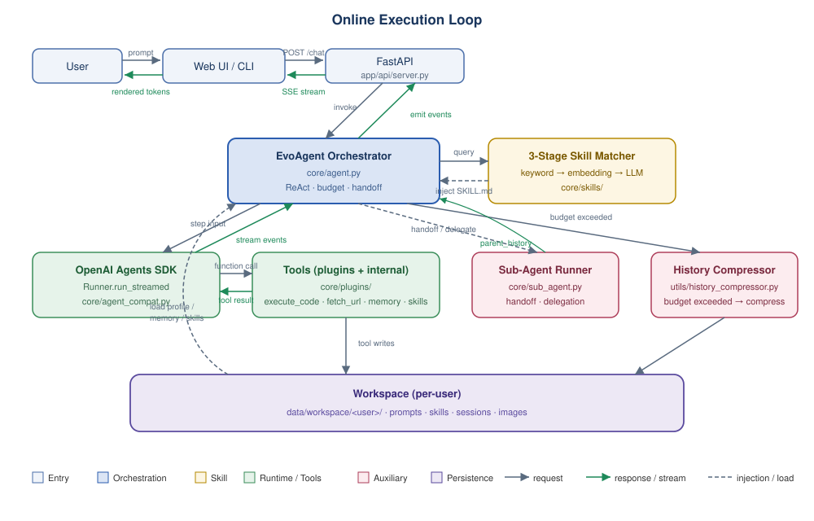
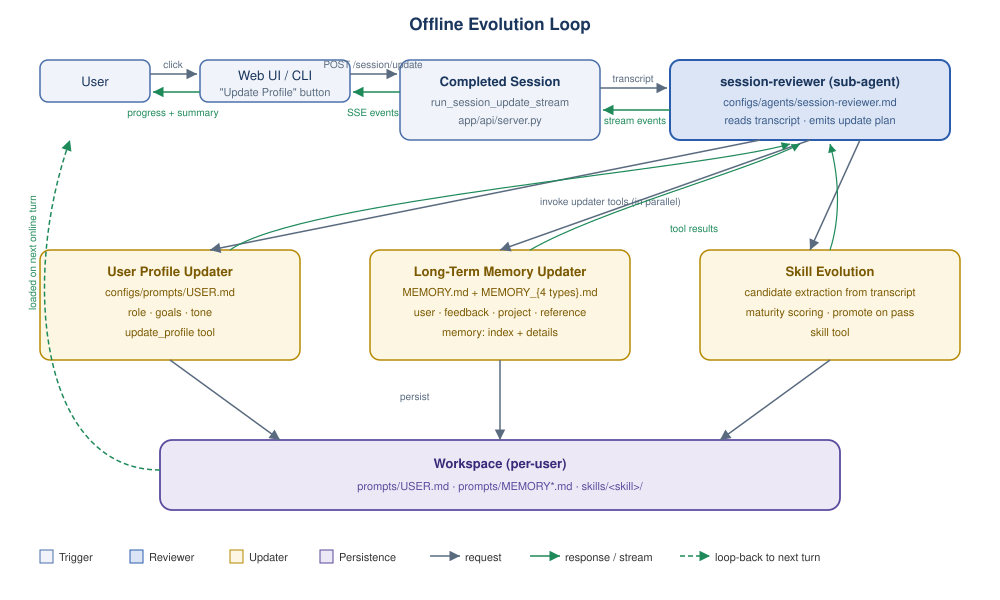

# EvoAgent

[](https://arxiv.org/abs/2604.20133)
[](LICENSE)

Official implementation of **"EvoAgent: An Evolvable Agent Framework with Skill Learning and Multi-Agent Delegation"** ([arXiv:2604.20133](https://arxiv.org/abs/2604.20133)).

[Reproducibility](REPRODUCIBILITY.md) · [Citation](#citation) · [Security](SECURITY.md) · [Contributing](CONTRIBUTING.md)

> **⚠️ Pre-release preview.** The paper is available on [arXiv:2604.20133](https://arxiv.org/abs/2604.20133); the detailed paper-to-code mapping will be attached in the upcoming official release. Author list in `CITATION.cff` is final.

> **📦 Scope of this release.** This repository is **not the complete production codebase** behind the paper. It has been scrubbed for open-sourcing: internal
> business logic, proprietary prompts, customer-specific skills, and integrations with closed-source internal services have been removed or replaced with
> generic reference implementations. The released code preserves the framework's architecture (orchestrator · 3-stage skill matcher · sub-agent runner ·
> history compressor · 4-type memory · offline evolution loop) and is sufficient to reproduce the methodology; absolute numbers from the paper's foreign-trade
> deployment, however, require the internal corpus and skill library and cannot be reproduced from this repo alone.

> **🧨 Runtime safety notice.** The repo ships **two deployment modes**, picked
> at startup by whether `MINIO_ENDPOINT` is set:
>
> - **LOCAL mode** (default, no `MINIO_ENDPOINT`). Workspace data lives on the
>   server's local disk under `data/workspace/{user_id}/`. `execute_code`
>   runs as a plain `subprocess` scoped to the user's workspace directory
>   (see `core/plugins/sandbox/local.py`). **There is no kernel-level
>   isolation** — the dispatcher's regex blacklist, cwd confinement, and
>   timeout are the only barriers. Use this mode for single-machine research
>   / paper reproduction only.
>
> - **MINIO mode** (set `MINIO_ENDPOINT`). Workspace data lives in a MinIO
>   bucket; `execute_code` runs in a one-shot Docker container on a
>   *separate* sandbox host that mounts the bucket via s3fs (see
>   [`core/plugins/sandbox/remote_docker.py`](core/plugins/sandbox/remote_docker.py)).
>   Storage and the sandbox runtime are decoupled from the server process,
>   so the server can be restarted / scaled and a sandbox escape can only
>   reach that user's bucket prefix. This is the recommended path for any
>   deployment with persistence requirements or more than one trusted user.
>
> Both modes still keep `execute_code` behind the same regex blacklist /
> timeout / output truncation; the difference is **where** the code runs
> and **what it can reach**. See [Deployment Modes](#deployment-modes) below
> for setup, and [SECURITY.md § 1](SECURITY.md) for the full caveat list.

---

## Overview

EvoAgent is an evolvable LLM-agent framework built around two coordinated loops:

- An **online execution loop** that runs user turns through a three-stage skill match, injects matched skills into the ReAct context, and compresses long histories on the fly.
- An **offline evolution loop** that reviews completed sessions, updates the user profile and long-term memory, extracts candidate new skills, and scores skill maturity.

The framework materialises the design philosophy of **Harness Engineering**: the reliability of an agent system is determined not only by the backbone model but also by the constraints, workflows, and feedback mechanisms around it. In a real-world foreign-trade deployment, integrating GPT-5.2 with EvoAgent improves a five-dimension LLM-as-Judge evaluation by ~28% on average over the same backbone model invoked directly (Section 4.1).

## Architecture

Following Figure 1 of the paper, EvoAgent is organised as five structural layers:

| Paper layer | Code entry point |
|---|---|
| API entry | `app/api/` |
| Orchestration | `core/agent.py::EvoAgent` |
| Runtime | OpenAI Agents SDK (`Runner.run_streamed`) via `core/agent_compat.py` |
| Tools + Session | `core/plugins/`, `utils/workspace.py` |
| Persistence | `utils/workspace.py`, `utils/history_compressor.py` |

The system runs two coordinated loops (Section 3 of the paper):

**Online execution loop** — every user turn loads profile/memory/skills from the per-user workspace, passes the query through a 3-stage skill matcher, injects matched `SKILL.md` into the ReAct context, then calls tools via the OpenAI Agents SDK. Long histories are compressed on the fly; complex turns may hand off to sub-agents.



**Offline evolution loop** — triggered after a session completes, the `session-reviewer` sub-agent consumes the transcript and emits three parallel updates: user profile (`USER.md`), long-term memory (`MEMORY.md` index + 4 typed detail files), and skill evolution (candidate extraction + maturity scoring). All writes land in the same workspace and are picked up on the next online turn.



The complete mapping between paper sections (methodology, appendix pseudocode) and source files will ship with the official release alongside the paper PDF.

## Quick Start

```bash
git clone https://github.com/Focus-AI-Center/Mentarc-EvoAgent
cd Mentarc-EvoAgent

conda create -n evoagent python=3.11 -y
conda activate evoagent
pip install -r requirements.txt

cp .env.example .env                 # fill in OPENAI_API_KEY, MODEL, etc.
python -m app.api.server             # launches FastAPI server on :8194
# or
python cli.py --user demo            # interactive CLI
```

The default `.env.example` has `MINIO_ENDPOINT` empty, which gives you the
**LOCAL** mode (workspaces in `data/workspace/`, `execute_code` via plain
subprocess). For multi-user / persistent / hardened deployments, switch to
**MINIO** mode — see the next section.

## Deployment Modes

| | **LOCAL** (default) | **MINIO** (recommended for >1 user) |
|---|---|---|
| Trigger | `MINIO_ENDPOINT` empty | `MINIO_ENDPOINT` set |
| Storage backend | `LocalFSBackend` (`data/workspace/{user_id}/`) | `MinIOSDKBackend` (S3 keys `{user_id}/...`) |
| Sandbox backend | `LocalSubprocessBackend` (plain subprocess) | `RemoteDockerBackend` (one-shot container on a separate host) |
| Workspace ↔ sandbox | direct file access on the same host | s3fs mount of the MinIO bucket inside the container |
| Server can be restarted/scaled? | No (state on local disk) | Yes (state in MinIO) |
| Cross-mode configs | rejected at startup (`make_sandbox_backend` / `get_backend`) | |

### Deploy MinIO

We do not bundle a MinIO deployment manifest. Use any release that supports
versioning + STS — single-node `minio:latest` is enough for development;
4-node distributed StatefulSet with EC:2 is recommended for production. See
the [official MinIO docs](https://min.io/docs).

Once it's up, create a bucket (default name in `.env.example`:
`evoagent-workspaces`) and copy its endpoint URL + access/secret keys.
The server will create the per-user prefixes (`{user_id}/prompts/...`,
`/skills/`, `/sessions/`, `/images/`, `/previews/`) on first interaction.

### Deploy the remote sandbox host (MINIO mode only)

Any Linux box with Docker, `/dev/fuse`, and network access to the MinIO
endpoint. We've tested on Alibaba Cloud Linux 3 / kernel 5.10; any
distribution with kernel ≥ 4.18 and Docker ≥ 20.10 should work.

```bash
# 1. On the sandbox host: install Docker if needed
curl -fsSL https://get.docker.com | sh
docker --version                 # >= 20.10
ls -la /dev/fuse                 # must exist; needed for s3fs in container

# 2. Build the sandbox image (run from the repo root, on the sandbox host or
#    against the remote daemon via DOCKER_HOST)
cd deploy/sandbox-image
docker build -t evoagent-sandbox:python3.11 .

# 3. (Optional) verify the image can mount your bucket
docker run --rm --cap-add SYS_ADMIN --device /dev/fuse:/dev/fuse:rwm \
  --security-opt apparmor=unconfined --network host \
  -e MINIO_ENDPOINT=<minio-url> \
  -e MINIO_ACCESS_KEY=<key> -e MINIO_SECRET_KEY=<secret> \
  -e MINIO_BUCKET=<bucket> -e USER_ID=_smoke \
  -e LANGUAGE=bash -e TIMEOUT_S=10 \
  -e CODE='ls -la; echo from-sandbox > probe.txt && cat probe.txt' \
  evoagent-sandbox:python3.11
```

The build pre-installs the whitelisted scientific stack (`numpy`,
`pandas`, `requests`, `httpx`) plus s3fs-fuse. Final image is ~300 MB and
takes ~1 min cold (apt cached) on a clean daemon. From a region without
PyPI reachability, the bundled `Dockerfile` already routes pip through
the Aliyun mirror; swap to your own mirror by editing
[`deploy/sandbox-image/Dockerfile`](deploy/sandbox-image/Dockerfile).

### Wire the server to the sandbox host

The Python `docker` SDK reads `DOCKER_HOST` from the environment. Three
transports, in order of preference:

| `DOCKER_HOST` | When to use |
|---|---|
| *(empty)* | Server runs on the same box as the docker daemon (e.g. server + sandbox host co-located). Uses `/var/run/docker.sock`. |
| `ssh://user@host` | Server is separate from the sandbox host. **Requires SSH public-key auth** (the SDK does not accept passwords). Set up via `ssh-copy-id` + ensure the host is in the server's `~/.ssh/known_hosts`. |
| `tcp://host:2375` | Daemon is exposed over TCP. Insecure unless behind a VPN or fronted by TLS (`tcp://host:2376` + `DOCKER_TLS_VERIFY=1`). |

Concrete example for `ssh://`:

```bash
# On the server box (one-time):
ssh-keygen -t rsa                                       # if ~/.ssh/id_rsa missing
ssh-copy-id root@<sandbox-host>                         # push pubkey
ssh-keyscan -H <sandbox-host> >> ~/.ssh/known_hosts     # accept fingerprint
ssh -o BatchMode=yes root@<sandbox-host> 'docker version'  # must succeed without prompting

# In .env on the server:
MINIO_ENDPOINT=http://<minio-host>:9000
MINIO_ACCESS_KEY=...
MINIO_SECRET_KEY=...
MINIO_BUCKET=evoagent-workspaces
SANDBOX_BACKEND=docker
SANDBOX_IMAGE=evoagent-sandbox:python3.11
SANDBOX_NETWORK=host
DOCKER_HOST=ssh://root@<sandbox-host>
```

On startup the server runs a fail-fast configuration check
([`app/api/server.py`](app/api/server.py)): it instantiates both backends,
logs `Runtime mode: MINIO  storage=MinIOSDKBackend  sandbox=RemoteDockerBackend`,
and refuses to start on inconsistent combinations (e.g. `SANDBOX_BACKEND=docker`
but no `MINIO_ENDPOINT`).

### Verify end-to-end

```bash
# 1. /health
curl -s http://localhost:8194/health
# {"status":"ok"}

# 2. Trigger an execute_code call and confirm the sandbox label is the docker one
curl -N -H 'Content-Type: application/json' http://localhost:8194/api/agent/chat \
  -d '{"userId":"smoke","sessionId":"s1","plugins":["execute_code"],
       "data":{"input":"用 execute_code 运行 print(2+3)"}}' \
  | grep -o '"sandbox": "[^"]*"' | head -1
# "sandbox": "docker(evoagent-sandbox:python3.11,net=host)"
```

A failure with `Cannot reach Docker daemon (...): Server '<host>' not found
in known_hosts` means `DOCKER_HOST=ssh://...` is set but key auth isn't
ready — re-run the `ssh-copy-id` / `ssh-keyscan` steps above.

## Repository Layout

```
Mentarc-EvoAgent/
├── app/                    # API entry layer (FastAPI + SSE)
├── core/
│   ├── agent.py            # EvoAgent orchestrator (Section 3.3)
│   ├── agent_compat.py     # BaseTool -> OpenAI SDK FunctionTool adapter
│   ├── sub_agent.py        # Sub-agent runner (Appendix A Phase 2.5)
│   ├── plugins/
│   │   ├── execute_code.py # Backend dispatcher (validation + sandbox.run)
│   │   └── sandbox/        # Pluggable sandbox backends
│   │       ├── local.py    # LocalSubprocessBackend (LOCAL mode)
│   │       └── remote_docker.py  # RemoteDockerBackend (MINIO mode)
│   └── skills/             # Three-stage skill matcher + skill manager
├── configs/
│   ├── prompts/            # SOUL.md / USER.md / MEMORY.md templates
│   ├── skills/skill-creator# Built-in meta-skill for authoring new skills
│   └── agents/             # (Empty) drop-in sub-agent configs
├── utils/
│   ├── workspace.py        # Per-user persistence (routes to backend below)
│   ├── storage_backend/    # Pluggable storage backends
│   │   ├── localfs.py      # LocalFSBackend (LOCAL mode)
│   │   └── minio_sdk.py    # MinIOSDKBackend (MINIO mode)
│   ├── history_compressor.py  # Structured history compaction
│   ├── embedding.py
│   └── token_counter.py
├── deploy/
│   └── sandbox-image/      # Dockerfile + entrypoint for evoagent-sandbox
├── evaluation/             # RQ1 / RQ2 / RQ3 experiment scripts
├── REPRODUCIBILITY.md
├── CITATION.cff
├── SECURITY.md
├── CONTRIBUTING.md
└── README.md
```

## Reproducing Paper Experiments

See [REPRODUCIBILITY.md](REPRODUCIBILITY.md). The end-to-end commands live under `evaluation/`:

```bash
# RQ1: backbone capability enhancement (baseline vs. EvoAgent, 5-dimension judge)
python evaluation/rq1_capability/run_eval.py --mode baseline  --test-set DATA --output ...
python evaluation/rq1_capability/run_eval.py --mode evoagent  --test-set DATA --output ...
python evaluation/rq1_capability/judge.py    --test-set DATA --baseline ...  --treatment ...

# RQ2: model-transferability study
MODEL=gpt-4.1        python evaluation/rq2_transferability/run_model_swap.py ...
MODEL=qwen-3.5-35b   python evaluation/rq2_transferability/run_model_swap.py ...

# RQ3: capability boundary / long-session stress test
python evaluation/rq3_boundary/long_session_stress_test.py --max-turns 420
```

## Test Dataset

The 172-sample foreign-trade corpus used in RQ1/RQ2/RQ3 (distilled from 664 multi-turn production dialogues) contains proprietary business data and is not bundled with this repository. A release that reproduces the exact numbers in the paper can be made available upon reasonable request for academic collaboration.

## FAQ

**Do I need every API key listed in `.env.example`?**
No. Only `OPENAI_API_KEY` is required. The others (Doubao, Tavily) only activate the matching plugin — leave them empty to disable that plugin. If `DEFAULT_PLUGINS=all`, unconfigured plugins will load but return a clear "API key not configured" error when the agent tries to call them.

**The agent says "Model not found" / 404 from my OpenAI endpoint.**
`MODEL`, `MODEL_VISION` and `COMPRESSION_MODEL` default to names from the paper's experimental setup. If your endpoint doesn't expose those names, override via env vars: `MODEL=gpt-4o`, `COMPRESSION_MODEL=gpt-4o-mini`, `MODEL_VISION=gpt-4o` are reasonable defaults on the public OpenAI API.

**What happens to my data?**
In LOCAL mode, every interaction is written to `data/workspace/{user_id}/` on the server process's local disk. In MINIO mode, the same per-user tree lives as keys under `{user_id}/...` in your MinIO bucket. Nothing is sent to third parties except the LLM calls you have configured. `.gitignore` excludes `data/` and `logs/` — don't commit them.

**Is `execute_code` safe?**
It depends on the deployment mode. In **LOCAL** mode it runs bash / Python via plain `subprocess` on the same host as the server, scoped to the user's workspace directory but with no kernel-level isolation — only suitable for single-tenant trusted use. In **MINIO** mode every invocation runs in a one-shot Docker container on a separate sandbox host with its workspace mounted via s3fs; an escape from the user's code is bounded by the container, the network rules around the docker daemon, and the scope of the MinIO credentials handed in (currently the server's root creds; M3 swaps them for STS tokens scoped to `{user_id}/*`). See [SECURITY.md § 1](SECURITY.md) for the full caveat list. If you don't need the tool at all, remove `"execute_code"` from `PLUGIN_CLASSES` in `core/plugins/__init__.py` or set `DEFAULT_PLUGINS` to an explicit list that excludes it.

**Can I deploy this behind a public URL?**
Not as-is. At minimum: put it behind an authenticating reverse proxy, disable `execute_code`, add rate limiting, and review [SECURITY.md](SECURITY.md) in full. This is a research codebase.

**How do I add my own plugin / skill / sub-agent?**
See [CONTRIBUTING.md](CONTRIBUTING.md) — short sections on each.

**The agent keeps saying "Hi, I'm EvoAgent" — can I change that?**
Edit `configs/prompts/SOUL.md`. On first interaction it is copied into the user's workspace at `data/workspace/{user_id}/prompts/SOUL.md` and thereafter overwritten from source on every server restart (so edits to the source template propagate).

**Why does `ruff check .` pass but my IDE shows warnings?**
The ruleset in `pyproject.toml` is deliberately loose (E, F, I, UP, B only — no line-length enforcement, no Pylint-style nitpicks). Tighten locally if you like, but CI only enforces the shipped config.

## Citation

If you use EvoAgent in your research, please cite:

```bibtex
@misc{zhang2026evoagent,
  title         = {EvoAgent: An Evolvable Agent Framework with Skill Learning and Multi-Agent Delegation},
  author        = {Aimin Zhang and Jiajing Guo and Fuwei Jia and Chen Lv and Boyu Wang and Fangzheng Li},
  year          = {2026},
  eprint        = {2604.20133},
  archivePrefix = {arXiv},
  primaryClass  = {cs.CL},
  url           = {https://arxiv.org/abs/2604.20133},
  note          = {Aimin Zhang is the corresponding author.}
}
```

See [CITATION.cff](CITATION.cff) for the machine-readable citation record.

## License

Apache License 2.0. See [LICENSE](LICENSE).
