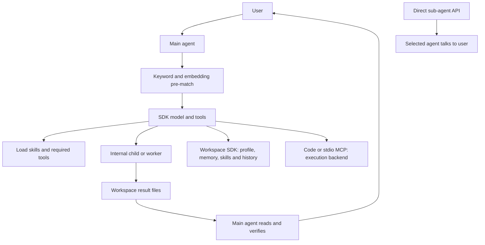

# Core mechanisms and documentation

This index describes the current implementation. The paper's architecture and
historical module names do not imply that every optional helper is active.

## Mechanism map

| Mechanism | Implementation | Guide |
|---|---|---|
| Online entry, session loading and SDK execution | [EvoAgent](../core/agent.py), [SDKRunSession](../core/runtime/execution.py) | [Runtime composition](runtime-components.md), [routing](skill-routing.md) |
| Skill pre-matching, lazy loading and tool grants | [Matcher](../core/skills/matcher.py), [mounter](../core/skills/tool_mounting.py) | [Skill routing](skill-routing.md), [tool lifecycle](agent-coordination.md#skill-guides-and-tool-grants) |
| Profiles, memory index and detail files | [Workspace](../utils/workspace.py), [memory tools](../core/plugins/internal.py) | [Memory](memory.md) |
| Skill review, references, patches, confirmation and undo | [Proposals](../core/skills/proposals.py), [manager](../core/skills/manager.py) | [Skill extraction](skill-extraction.md), [acceptance](acceptance-skill-references.md) |
| Main/child roles, direct sessions and automatic handoff | [Runner](../core/sub_agent.py), [audience instructions](../core/runtime/delegation_context.py), [internal results](../core/runtime/internal_delegation.py) | [Agent coordination](agent-coordination.md), [audience contract](runtime-contracts.md#delegation-audience) |
| Background workers, file results, budgets and cancellation | [Worker tools](../core/plugins/workers.py), [registry](../core/runtime/workers.py) | [Workers](workers.md) |
| Workspace agent definitions and defaults | [Agent registry](../core/agent_registry.py), [Workspace](../utils/workspace.py) | [Agent definitions](workers.md#agent-definitions) |
| Tool Search, exact loading, BM25F ranking, schema budgets and MCP policies | [Catalog](../core/tool_search.py), [ranking](../core/tool_search_ranking.py), [MCP](../core/mcp/manager.py), [policy](../core/runtime/tool_policy.py) | [Tool Search](tool-search.md), [MCP setup and execution](mcp.md), [cloud execution](cloud-agent.md) |
| Context compression, unloading and deterministic recovery | [Compaction](../core/context_compaction.py), [compressor](../utils/history_compressor.py), [recovery](../utils/context_recovery.py) | [Context compression](context-compression.md) |
| Questions, typed tool outcomes and token/cost accounting | [Questions](../core/runtime/questions.py), [outcomes](../utils/tool_results.py), [usage](../utils/usage.py) | [Runtime contracts](runtime-contracts.md) |
| SSE events and client consumption | [Events](../core/runtime/events.py), [HTTP routers](../app/api/routers/) | [SSE protocol](runtime-contracts.md#sse-event-protocol) |
| Disconnect/closure handling and history persistence | [Turn persistence](../core/runtime/interruption.py) | [Interrupted history](runtime-components.md#interruption-lifecycle) |
| LocalFS, MinIO, code execution and session Docker lifecycle | [Storage backends](../utils/storage_backend/), [sandbox backends](../core/plugins/sandbox/) | [Cloud Agent](cloud-agent.md), [deployment](../README.md#deployment-modes), [security](../SECURITY.md) |
| Progress cards, artifact downloads and history replay | [Web UI](../app/static/index.html), [file endpoint](../app/api/routers/workspace.py) | [Worker progress](workers.md#dispatch-and-collection), [internal receipts](agent-coordination.md#invocation-audience-and-internal-results) |

## Online execution

1. The API creates a user Workspace and loads the current session, profile,
   memory index, skill catalog and effective agent definitions.
2. Ordinary task execution tries keyword and embedding pre-matching. Without a
   pre-match, the main model uses the catalog and can load skills itself. A
   matched `requires_sub_agent` skill runs an internal child first.
3. The SDK runs tools. Skill loading grants dependencies; Tool Search discovers
   configured capabilities; policies remain attached to the current agent.
4. Compression runs at turn and SDK step boundaries. Worker progress can stream
   while the main agent continues independent work. The main agent collects and
   checks delegated files before replying or asking the user a question.
5. Normal completion saves history. Cancellation closes execution and preserves
   confirmed facts and partial output when storage succeeds. Session completion
   does not automatically start a memory/skill review.

## Operational boundaries

- An ordinary agent profile can serve a direct user session or an internal
  delegation. The runtime appends the internal audience instruction only for
  delegation; it does not rewrite the user's stored agent definition.
- The memory index, original memory files, skill definitions, history and output
  artifacts are different objects. A context summary does not overwrite them.
- Background workers belong to one API request. Workspace files are durable
  data, not persistent job ownership, a lock or a restart-resumable queue.
- Task completion, successful tool execution, verified correctness and user
  delivery are separate facts. Progress cards describe execution.
- LocalFS code runs on the host. MinIO mode uses the existing session Docker
  backend. Output directories and tool policies do not provide OS isolation.

## Browser scheduling and skill statistics

`schedule_manager` emits schedule records through code 7; the built-in UI keeps
them in browser local storage. Its JavaScript timer checks schedules every
30 seconds and starts ordinary `/api/agent/chat` requests. Execution depends on
that browser being open and able to run timers. This is not a server cron service
or the background worker registry, and schedules are not Workspace jobs.

The growth panel derives maturity labels from stored `usage_count` and
`success_rate` metadata. The current counter increment occurs when the main matcher injects an ordinary
guide that is not already loaded. Manual guide reads, worker preloads and child
handoffs do not have a general per-execution counter. It is not proof of
successful business completion.
`success_rate` defaults to 1.0, and ordinary turns do not automatically measure or
recompute it. These UI labels are descriptive heuristics, not evaluated quality
scores. Review and candidate changes follow the confirmation flow in
[skill extraction](skill-extraction.md).

## Logging

[The logger](../utils/logger.py) writes API-process logs under `LOG_DIR`, default
`logs/`, with daily names such as `evoagent_2026-11-23.log`. `LOG_LEVEL` selects
stderr verbosity. Logs are separate from user Workspace history and artifacts;
the defaults and supported deployment variables are in [.env.example](../.env.example).

## Maintaining the documentation

Changes to an entry point, role, storage object, lifecycle or limit should update
the corresponding guide above and its relevant examples. Keep the standalone
reference pages authoritative, and use this index to locate them. The offline
suite covers these contracts; live model quality and external Docker/MinIO
deployment behavior require separate integration verification.

For the pinned formatter version, workflow jobs and local presubmit commands, see
[Continuous integration](../CONTRIBUTING.md#continuous-integration).
