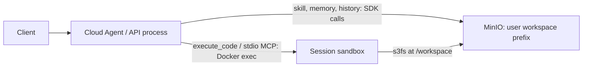

# Cloud Agent architecture and sandbox runtime

EvoAgent can run as a Cloud Agent: the API process orchestrates the model and
workspace tools, MinIO stores durable user state, and a session sandbox supplies
an execution environment when a task needs code or a stdio MCP process.

A cloud workspace is an object namespace. It remains available to the Agent even
when no execution container is running. This is why ordinary skill and memory
operations use workspace tools directly instead of requiring a shell command.

## Two paths to the same workspace



| Task | Preferred path | Reason |
|---|---|---|
| Load a skill or read a reference | `skill(get)` / `skill(get_ref)` -> Workspace -> MinIO SDK | Read stored text without a sandbox invocation |
| Save a skill and text references | `skill(save)` / `skill(ref_set)` -> Workspace -> MinIO SDK | Validate paths and update objects directly |
| Read or update durable memory | `memory` -> Workspace -> MinIO SDK | Resolve titles, preserve index conventions and handle competing writes |
| Run a helper or transform a dataset | `execute_code` -> session Docker exec -> mounted workspace | A process, dependencies and computation are required |
| Run a configured stdio MCP server | MCP consumer -> Docker exec in the same session sandbox | Keep its process and JSON-RPC stream alive |

In LOCAL mode the same workspace tools use `LocalFSBackend` and execution uses
`LocalSubprocessBackend`. MinIO and Docker form the cloud deployment mode;
setting `MINIO_ENDPOINT` selects them together.

## Why a skill tool reads references instead of bash

For a normal reference read, the Agent calls:

```python
skill(action="get_ref", name="buyer-lead-screening", ref_filename="rules.md")
```

The API process resolves the workspace path and reads MinIO through its SDK.
It does not call Docker or require an execution container. Likewise, `save` and
`ref_set` write text through the storage backend without starting a shell.

A bash read of the same content would use an additional sandbox execution path:
obtain or start the session container, connect through Docker exec, start the
shell and read through the s3fs filesystem view. A cold session also has container
startup and mount costs. Warm sessions reuse the container, but still incur the
Docker exec, shell and filesystem layers.

Direct storage access avoids those layers and is the intended lower-latency path
for ordinary text operations. This is an architectural rationale, not a measured
latency ratio. The current reference reader may list and read multiple reference
objects before selecting one; a direct tool call does not necessarily mean a
single MinIO request.

Bash remains useful when the task requires execution: run `scripts/`, search or
transform many files, inspect generated artifacts, or select additional lines
from a long memory body. `memory(get)` returns at most 8,000 body characters and
then points to the source file for optional `cat` or `sed` reads. Use the skill
tool for ordinary reference retrieval; an execution round trip is unnecessary.

## Object keys and execution paths

For user `alice`, the same file has these two representations:

| Representation | Example |
|---|---|
| MinIO key | `alice/skills/buyer-lead-screening/references/rules.md` |
| Sandbox file | `/workspace/skills/buyer-lead-screening/references/rules.md` |
| Skill-relative path | `references/rules.md` |

The container entrypoint mounts `{bucket}:/alice` at `/workspace`. It does not
copy the full workspace into a container-local checkout. Server-side SDK writes
and sandbox-side s3fs operations address the same object namespace. Files under
`/workspace` are persistent objects; files outside the mount, installed packages
and live processes belong to the container and may disappear when it is removed.
Object storage with s3fs is not a full POSIX filesystem, and filesystem views may
cache metadata. Do not assume that sharing an object namespace gives transactional
cross-file updates or makes arbitrary concurrent filesystem writes safe.

Loaded skills include their directory relative to the workspace. For an existing
helper, use:

```python
execute_code(language="bash", code="python scripts/run.py",
             cwd="skills/buyer-lead-screening")
```

Template sync retains `scripts/`, `assets/` and `references/` in their original
locations, including binary content. Reference tools still target text files
under `references/`; use execution tools to create or process other resources.

## Session sandbox lifecycle

The selected MINIO-mode backend is
[`SessionDockerBackend`](../core/plugins/sandbox/session_docker.py).
[`RemoteDockerBackend`](../core/plugins/sandbox/remote_docker.py) remains a legacy
one-shot implementation and is not selected by the current factory.

1. **Allocate lazily.** The backend looks up `(user_id, session_id)` when execution
   or stdio MCP needs it. Basic skill/reference operations do not allocate a
   sandbox. API startup can still contact Docker for orphan cleanup.
2. **Create a session container.** The Docker SDK connects to the local socket or
   `DOCKER_HOST`, starts `SANDBOX_IMAGE` and labels the container with its user and
   session. The image must be available on the Docker daemon host.
3. **Mount the workspace.** The entrypoint writes the s3fs credential file as root,
   mounts only the user prefix at `/workspace`, removes credential variables from
   its own environment and stays alive in session mode.
4. **Execute commands.** Each `execute_code` call runs a new Docker exec command as
   the unprivileged `sandbox` user. It applies the requested workspace-relative
   cwd and invokes bash or Python with a command timeout. A new shell does not
   retain an earlier shell's `cd` or exported variables.
5. **Reuse the container.** Later calls for the same key use the existing container.
   stdio MCP servers run as additional processes there. Separate session IDs use
   separate containers but still address the same user's persistent workspace.
6. **Recycle.** A reaper checks idle sessions every 60 seconds; the default idle
   TTL is 900 seconds. A stopped container is recreated when needed. API shutdown
   closes MCP sessions and removes owned session containers. Startup cleanup
   removes containers with the session-sandbox label left from an earlier process.

MCP sockets have their own `(user_id, session_id, server_name)` registry and idle
TTL. Closing one MCP connection does not imply that every process or the shared
session container has been removed.

## Configuration and limits

See [.env.example](../.env.example) for the complete configuration template.

| Setting | Current behavior |
|---|---|
| `MINIO_ENDPOINT`, `MINIO_ACCESS_KEY`, `MINIO_SECRET_KEY`, `MINIO_BUCKET` | Server storage and sandbox mount connection |
| `SANDBOX_BACKEND` | `docker` by default in MINIO mode; `k8s` is not implemented |
| `DOCKER_HOST` | Local socket when omitted; remote daemon via SSH or configured TCP transport |
| `SANDBOX_IMAGE` | Defaults to `evoagent-sandbox:python3.11` |
| `SANDBOX_NETWORK` | Container network mode; defaults to `host` |
| `SANDBOX_SESSION_MEMORY_MB` | Session-container memory limit; falls back to `EXECUTE_CODE_MEMORY_MB`, then 512 MB |
| `SANDBOX_SESSION_IDLE_TTL` | Idle TTL in seconds; falls back to `MCP_STDIO_IDLE_TTL`, then 900 |
| `SANDBOX_SESSION_CLEANUP_ON_START` | Startup orphan cleanup; enabled by default |
| `MCP_STDIO_IDLE_TTL` | Idle TTL for stdio MCP connections; default 900 seconds |
| `execute_code.timeout` | Per-command timeout, default 30 seconds, clamped to 1-120 |

Command output is capped at 10,000 characters for each stdout/stderr stream.
Command timeout affects the exec command, not the lifetime of the reusable
container. `SANDBOX_SESSION_CONTAINER_TIMEOUT` is passed into the entrypoint,
but session mode currently stays alive until cleanup; it is not an enforced
maximum session age. The old `SANDBOX_TIMEOUT_S` setting is not consumed by the
selected backend.

The session backend uses container-wide network and memory settings. It does not
implement per-call network isolation from `EXECUTE_CODE_NETWORK=deny`; configure
actual network policy on the sandbox host/container network. s3fs requires FUSE,
`SYS_ADMIN` and the configured AppArmor relaxation. User-prefix mounting limits
the filesystem view; it does not replace scoped storage credentials or stronger
runtime isolation. Current containers receive the configured server MinIO
credentials, not automatically generated per-user STS credentials. See
[deployment boundaries](../SECURITY.md) for the existing security posture.

## Persistence and API-process ownership

MinIO keeps prompts, memory, skills and session JSON independently of execution
containers. A container restart does not intentionally delete those objects.
Live processes, MCP sockets and sandbox registries are owned by the API process;
this release does not provide distributed sandbox ownership or reattachment.

Use one API-process owner for a shared sandbox fleet. Startup cleanup selects all
containers with the session-sandbox label on that Docker daemon, so starting a
second uncoordinated worker can remove another worker's active containers. Extra
API workers or replicas require ownership-aware routing, cleanup and lifecycle
coordination; moving durable state to MinIO alone does not provide that.

Implementation: [workspace operations](../utils/workspace.py),
[storage adapter](../utils/storage_backend/minio_sdk.py),
[skill tool](../core/plugins/internal.py),
[sandbox selection](../core/plugins/sandbox/__init__.py),
[session runtime](../core/plugins/sandbox/session_docker.py),
[container entrypoint](../deploy/sandbox-image/entrypoint.sh),
[stdio MCP sessions](../core/mcp/sandbox_session.py) and
[API lifecycle hooks](../app/api/server.py).
