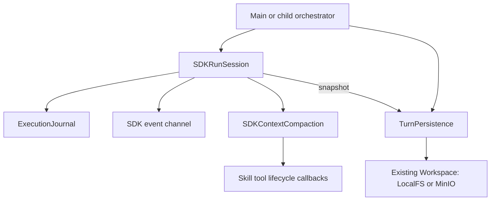

# Runtime components and interrupted history

For example, an agent starts two tool calls. One returns a report while the
other is still waiting when the browser disconnects. The next turn needs the
real report result and the pending call's arguments. Recording both as failed
could repeat completed work; recording both as completed would invent a result.

## Composition

Main and child agents share these components:

| Component | Responsibility |
|---|---|
| `core/runtime/history.py` | SDK input/history conversion and normalization |
| `core/runtime/events.py` | SDK-to-SSE projection and delegated event channels |
| `core/runtime/execution.py` | One SDK run: execution journal, events and compaction |
| `core/runtime/interruption.py` | Turn persistence and cancellation/closure adapter |
| `core/runtime/sdk_client.py` | Shared proxy-aware SDK client initialization |
| `core/runtime/questions.py` | End asking runs and resolve answers from saved question identity |
| `core/runtime/delegation_context.py` | Current input/attachment snapshots and prior source references |
| `core/runtime/usage.py` | Request usage scope and deduplicated SDK accounting |
| `core/context_compaction.py` | Replace model history at SDK step boundaries |
| `core/delegation.py` | Task identity, delivery receipts and automatic handoff |
| `core/skills/tool_mounting.py` | Skill-specific tool grants and unloading |



Routing, model settings and domain configuration remain in the orchestrators.
Shared modules have explicit inputs and do not import either agent implementation.
Existing delegation, compaction and skill modules retain their own boundaries;
there is no general plugin registry or event bus for these lifecycle operations.
The standalone session updater remains a separate flow.

See [runtime contracts](runtime-contracts.md) for question boundaries and answer
routing, delegation source separation, tool outcomes and measured usage.

`SDKRunSession` composes the existing compaction adapter with an execution journal
and SSE channel. The journal records each tool completion through SDK hooks,
which is important because the SDK can wait for an entire parallel batch before
adding its items to the final history. Raw response events preserve partial text
and complete tool arguments; display truncation does not limit saved arguments.

After compression, journal identities represented in the new summary are
retired. Late stream events cannot reappend those old items to history. Usage,
raw responses and already queued display events retain their existing behavior.

## Interruption lifecycle

`TurnPersistence` receives a workspace, identity and snapshot supplier. The
`persist_on_interrupt` adapter starts a turn and handles `CancelledError` and
`GeneratorExit`. Main and child agents use the same implementation.

1. Mark history as loaded only after its read completes. Cancellation during
   loading cannot replace an unread existing session with an empty one.
2. Track whether this turn's user message was appended, so equal consecutive
   user messages are preserved without adding the current message twice.
3. On interruption, close the active stream in its original task/context. The
   SDK run and event producer are cancelled before taking the final snapshot.
4. Keep completed results. Add explicit `status=interrupted, outcome=unknown`
   results for outstanding tool calls, preserving call/result pairing. These
   records say local waiting stopped, not that the remote action did not happen.
5. Preserve unfinished assistant text with an incomplete-response label. Do not
   fabricate closing JSON, a completed business card or a successful result.
6. Append an execution-interrupted note and save through the existing workspace.
   Cleanup emits no new SSE events and never automatically retries tools.

Explicit and skill-triggered delegation preserve the child task ID on
interruption, including IDs generated after the original model call. Partial
display events remain available for replay. A later agent can verify the child
history using the original thread rather than create a new task accidentally.

Both HTTP chat routers explicitly close their source generators when the SSE
response closes. Shielding handles Starlette/AnyIO cancellation scopes as well
as repeated direct asyncio cancellation. CLI and direct `run_stream` consumers
receive the same behavior when they cancel iteration or call `aclose()`.

## Saved data

The existing session JSON retains `conversation` and `message_count`. Interrupted
records add `interrupted=true` and `interruption_reason` (`cancelled` or `closed`).
Tool messages contain their original IDs and facts. Unconfirmed calls have an
interruption result; they are not described as successful. Assistant partials
carry `partial=true`. Child records retain `agent_type`.

Normal final saves use the same persistence component. If cancellation arrives
during a final write, that write is allowed to finish and is not duplicated by
interruption cleanup. Closing after `stream_end` does not add an interruption
note to an already saved completed turn.

`SESSION_SAVE_TIMEOUT_SECONDS` defaults to 15 seconds for each final storage
write. A timeout or storage error is logged and is never marked as a successful
save. There is no immediate second write when the first write's outcome is
unconfirmed. Source cleanup and nested child cleanup are additional work outside
that storage timeout.

## Boundaries

- Redis is not required. This feature concerns lifecycle and storage writes,
  not cross-process session locking.
- Main and child execution do not acquire session execution locks. Concurrent
  requests sharing a session can replace each other's history snapshots; the
  history writer does not currently check a loaded revision. This component does
  not provide exactly-once execution or distributed ownership.
- A process crash, forced termination or power loss may bypass cleanup. Durable
  checkpoints during execution are a separate feature.
- A storage timeout stops waiting; a synchronous backend operation running in a
  worker thread may still finish later. This is not a remote rollback guarantee.
- A consumer must close or cancel the stream. Merely abandoning an open iterator
  has no immediate cleanup guarantee.

## Verification

```bash
PYTEST_DISABLE_PLUGIN_AUTOLOAD=1 python -m pytest -p asyncio \
  tests/unit/test_interrupted_history.py tests/unit/test_sdk_compaction.py \
  tests/unit/test_agent_coordination.py -q
```

Offline tests exercise real SDK loops and ASGI disconnects for main/child entry
points, partial replies, parallel completions, generated child IDs, cancellation
during loading and saving, explicit closure, save deadlines and normal completion.
They also check that shared modules import without importing either agent.
